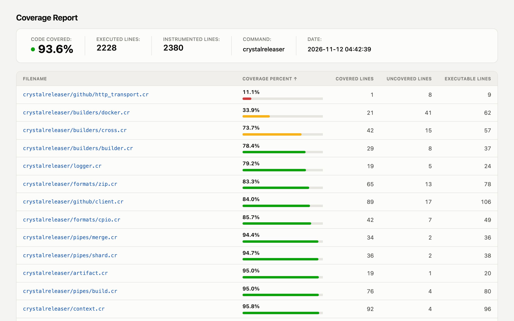
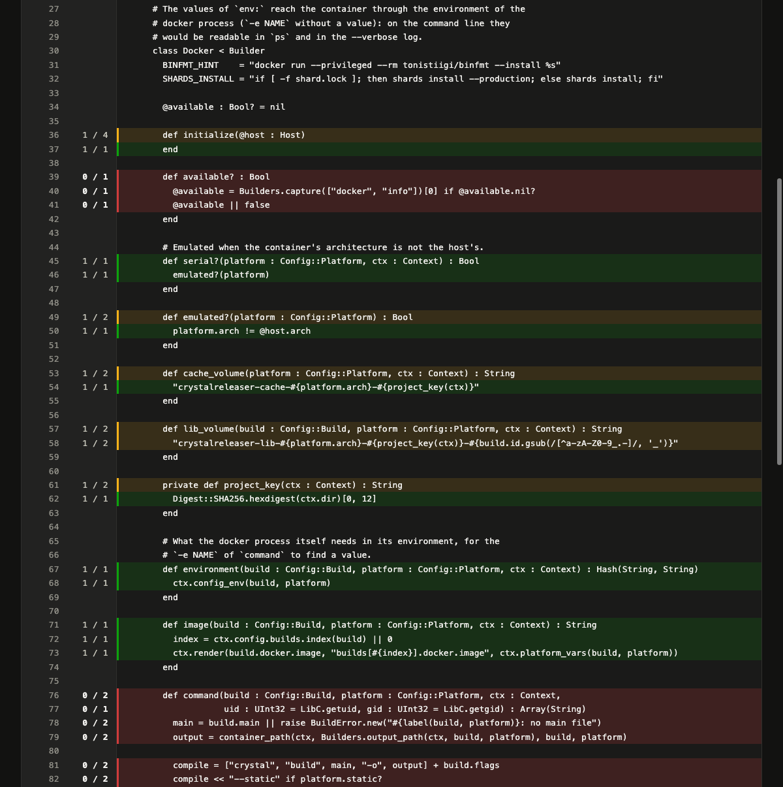

# kcov Template

A stylesheet for [kcov](https://github.com/SimonKagstrom/kcov) HTML coverage reports: summary as stat tiles, full-width file table with coverage bars and a sticky header, source pages with a gutter and full-width line highlighting, light and dark themes.

kcov's HTML is compiled into the binary and cannot be replaced. This only restyles it, through kcov's own `css-file` option.





## Usage

Copy `kcov.css` into your project, then pass it to kcov:

```sh
kcov --configure=css-file=kcov.css,command-name=myapp \
  --path-strip-level=1 \
  --include-path="$PWD/src" \
  coverage ./path/to/test-binary
```

- `css-file` replaces every `bcov.css` kcov writes in the report.
- `command-name` is the name shown in the summary and the window title, instead of the binary's.
- `--path-strip-level=1` shows file names relative to the common source folder. kcov still prefixes them with `[...]/`; the stylesheet hides it. Keep the level at 1 or more: at 0, kcov writes full paths without that prefix, and the stylesheet would hide their first 6 characters.

## Notes

- The theme follows the system setting (`prefers-color-scheme`). There is no toggle: that would take markup kcov does not let you add.
- Coverage colors are kept for coverage state only, and never carry it alone: the percentage and the hit counts stay next to every colored mark.
- The colors follow kcov's own thresholds, `--limits=low,high` (25 and 75 by default).
- The "Order" column of the source pages and their legend chips are hidden.
- Built against kcov 43. The stylesheet targets kcov's class names and table layout, so a kcov release that changes its HTML may need an update here.

## License

[MIT](LICENSE)
